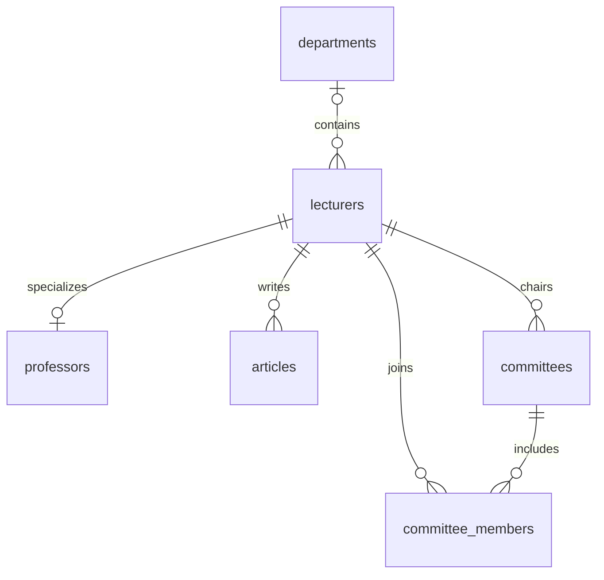

# College Management with PostgreSQL

A Java console application that stores college lecturers, departments, research articles and committees in PostgreSQL. This project extends a file-based Java application with JDBC queries, relational constraints and a database trigger for committee-chairman eligibility.

**Authors:** [Asaf Ziv](https://github.com/AsafZiv1908) and Iness Goldes. Developed as an academic database project.

## Features

- Manage academic staff, department assignments and committee membership.
- Use parameterized JDBC statements for application database operations.
- Query salary averages, research-article counts and committee details.
- Model many-to-many committee membership with a junction table.
- Enforce a chairman's `DR` or `PROFESSOR` degree with a PostgreSQL trigger.

## Technology

Java, JDBC, PostgreSQL, SQL and PL/pgSQL. The relational schema uses primary keys, foreign keys, check constraints and referential actions. The Java domain classes retain the original object-oriented structure.

## Data model



A lecturer may be unassigned to a department. `committee_members` uses the committee and lecturer identifiers as a composite primary key. The sample records supplied with the schema are demonstration data.

## Run locally

Requirements: **JDK 17 or newer**, a running PostgreSQL server, the `psql` command-line tool and a PostgreSQL JDBC driver JAR.

```powershell
git clone https://github.com/AsafZiv1908/college-management-database.git
cd college-management-database
```

Create a `lib/` directory and place the PostgreSQL JDBC driver JAR in it. The run script includes `lib/*` on the Java classpath. Driver files are local dependencies and are excluded from Git.

Initialize a new database:

```powershell
psql -U postgres -d postgres -f sql/01-create-database.sql
psql -U postgres -d college_management -f sql/02-schema-and-sample-data.sql
```

The first script creates the database. The second connects to that database and creates its schema and sample records. Run them once on a new installation; they are not repeatable migrations.

Set the connection configuration in the same PowerShell session and launch:

```powershell
$env:DB_URL = 'jdbc:postgresql://localhost:5432/college_management'
$env:DB_USER = 'postgres'
$databaseCredential = Get-Credential -UserName 'postgres' -Message 'PostgreSQL credentials'
$env:DB_PASSWORD = $databaseCredential.GetNetworkCredential().Password
.\run.ps1
```

`DB_URL` and `DB_USER` default to the values shown above. `DB_PASSWORD` is required and is read from the process environment. The application does not automatically load `.env` files. Choose menu option `0` to close the connection and exit.

To compile without connecting to a database, run `.\build.ps1`.

## Source and documentation

| Location | Purpose |
| --- | --- |
| [Java source](src/college/management/) | Console application, domain classes and JDBC operations |
| [DatabaseConnections.java](src/college/management/DatabaseConnections.java) | Environment-based connection configuration |
| [Schema and sample data](sql/02-schema-and-sample-data.sql) | Tables, constraints and validation trigger |
| [Example queries](sql/03-example-queries.sql) | Reports, joins, aggregates and update examples |
| [Project presentation](docs/college-management-presentation.pptx) | Original schema overview and trigger demonstration |
| [Development reflection](docs/development-reflection.md) | AI-assisted development, review and testing approach |

Run example queries individually. The query file includes updates, and its final chairman update intentionally violates the degree rule to demonstrate trigger rejection.

## Verification and scope

The Java source was compiled with JDK 23 during portfolio preparation. A fresh end-to-end database test was not performed against a configured PostgreSQL server. The original application reports connection errors but leaves the menu available; ensure the connection succeeds before using database operations.

This repository is an academic implementation, not a production service. The companion [file-based Java version](https://github.com/AsafZiv1908/college-management-java) shows the original persistence approach.
